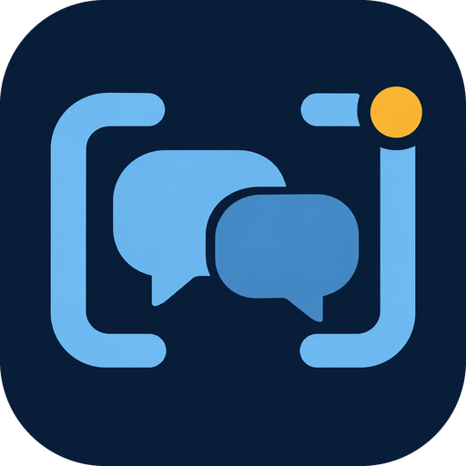
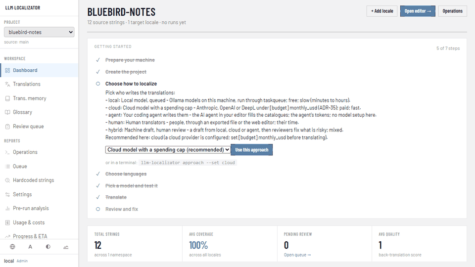
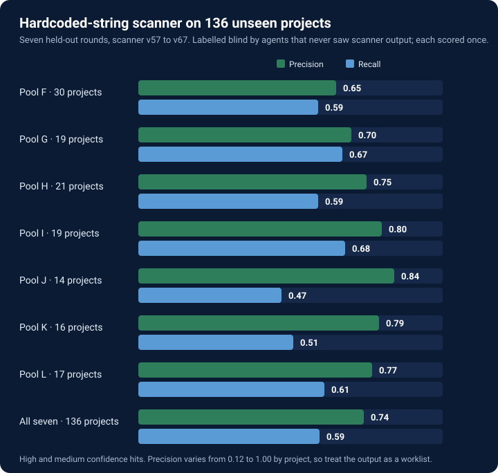

<p align="center"></p>

# llm_localizator

[](https://github.com/wwylon/llm_localizator/blob/main/LICENSE)
[](https://www.python.org/)
[](https://pypi.org/project/llm_localizator/)

**Find the strings your app forgot to translate, translate them with a local or cloud LLM, and
check every placeholder and plural before it ships.** One CLI (`llm-localizator`), a local review
UI, and a CI gate.

On PyPI the package is `llm_localizator`. It is not related to the `llm-localize` package on PyPI (a different project).



Your catalogues, glossary and context notes stay in your repository; llm_localizator reads them and
writes translations back through the paths you configure.

## Why

- **A hardcoded-string finder that measures itself.** `agent-hardcoded` lists UI text that never
  went through a translation call, with high, medium or low confidence per hit. It is
  benchmarked on held-out open-source projects that were never used to tune it, labelled blind.
  On the seven latest held-out rounds (136 projects, 2026-11) macro precision was 0.74 and macro recall 0.59:
  about seven in ten of what it reports is right, and it finds about three in five of the labelled text, with large
  differences between ecosystems. JavaScript, TSX, HTML, Vue, Svelte, Astro, ERB, XML UI files and Godot
  scenes are at the **supported** tier; 40 languages and formats are scanned in all. Tiers,
  numbers and known gaps: [docs/scanners.md](docs/scanners.md). `explain-scan FILE:LINE` says
  why a line was or was not reported.

  
- **Review like a translation team, not a diff.** A local web UI with roles, per-locale
  assignments, tasks with due dates, approve-only publishing, translation memory, glossary
  editing, history and back-translation scores, so people review what the model wrote.
- **Pick the engine that fits your budget and hardware.** Claude Haiku 5.5 runs every role with
  no GPU for about $0.12 per 2,300-key locale sweep; DeepSeek and OpenAI are also built in; local
  Ollama profiles are sized for 4, 8 and 16 GB GPUs and cost nothing. `llm-localizator engine
  recommend` picks one from your API keys and GPU.
- **Built for automation.** Every command runs from the CLI or the web UI. Long translation
  runs can go through a task queue, `check-keys` and `validate` gate CI with no model, and
  `agent-backlog` plus an MCP server give coding agents paste-ready work.

## Quick start

```bash
pip install llm_localizator
cd your-project
llm-localizator engine recommend     # which engine fits this machine
llm-localizator init                 # write .llm-localize.toml
llm-localizator translate            # translate missing and stale keys
llm-localizator validate             # placeholders, plurals, glossary (no model)
llm-localizator web                  # review UI on http://127.0.0.1:8770
```

Not sure what to do next? `llm-localizator guide` prints a checklist and the next command.
Details: [docs/getting-started.md](docs/getting-started.md).

Local engines need [Ollama](https://ollama.com): install it, run `ollama serve`, then
`ollama pull` the model the engine names.

## Engines

| Engine | Runs on | Notes |
|--------|---------|-------|
| `claude-haiku` | Cloud, no GPU | About $0.12 per 2,300-key locale sweep; default for cloud projects |
| `deepseek` | Cloud, no GPU | Best mean back-translation score in a Polish smoke test |
| `openai` | Cloud, no GPU | Not benchmarked on this pipeline yet |
| `local-4gb` | Ollama, 4 GB GPU | translategemma:4b for every role |
| `local-8gb` | Ollama, 8 GB GPU | aya-expanse:8b for every role |
| `local-16gb` | Ollama, 16 GB GPU | aya translates, qwen2.5:14b scores and improves |
| `hybrid-local-haiku` | Ollama + cloud | Local translation, Haiku scoring |

`llm-localizator engine list` shows each engine's evidence status and whether this machine can run
it. Cloud engines never switch cloud on by themselves: they need `[privacy] allow_cloud = true`
and a monthly budget. See [docs/providers.md](docs/providers.md).

## Formats

JSON (nested and flat: i18next, next-intl, react-intl, vue-i18n), YAML (Rails), gettext `.po`,
Flutter `.arb`, Android XML, iOS `.strings` / `.stringsdict` / `.xcstrings`, XLIFF, `.resx`,
Java `.properties`, Qt `.ts`, Laravel and PHP arrays, go-i18n, Chrome extension messages and CSV.
ICU is the interchange model, so validation and prompts see one shape whatever is on disk:
[docs/catalog-adapters.md](docs/catalog-adapters.md).

## Documentation

| Topic | Doc |
|-------|-----|
| First project, step by step | [docs/getting-started.md](docs/getting-started.md) |
| Every command and flag | [docs/cli.md](docs/cli.md) |
| `.llm-localize.toml` reference | [docs/configuration.md](docs/configuration.md) |
| Hardcoded-string scanner | [docs/scanners.md](docs/scanners.md) |
| What each validation rule checks | [docs/validation-rules.md](docs/validation-rules.md) |
| Catalogue formats and plural bridging | [docs/catalog-adapters.md](docs/catalog-adapters.md) |
| Providers and engines | [docs/providers.md](docs/providers.md) |
| The web interface | [docs/web.md](docs/web.md) |
| CI integration | [docs/ci.md](docs/ci.md) |
| Coding agents and MCP | [docs/agents.md](docs/agents.md) |
| Browser runtime for plain JS apps | [docs/web-runtime.md](docs/web-runtime.md) |
| Queue integration | [docs/taskqueue-integration.md](docs/taskqueue-integration.md) |
| Choosing and comparing models | [docs/model-evaluation.md](docs/model-evaluation.md) |
| Design decisions | [docs/decisions/](docs/decisions/README.md) |

## Transparency

- No telemetry, no phone-home. `validate`, `scan`, `status`, `check-keys` and `agent-hardcoded`
  are local computation with no network access.
- Text leaves your machine only when you choose a cloud engine and enable it with
  `[privacy] allow_cloud = true` and a budget. API keys are read from the environment.
- The review server binds to `127.0.0.1` and needs a per-session token for every write.
  See [SECURITY.md](SECURITY.md).

## Contributing

Issues and PRs are welcome: [CONTRIBUTING.md](CONTRIBUTING.md). The default test run is
hermetic (no model, no GPU, no network): `uv run pytest`.

## License

[MIT](LICENSE)
